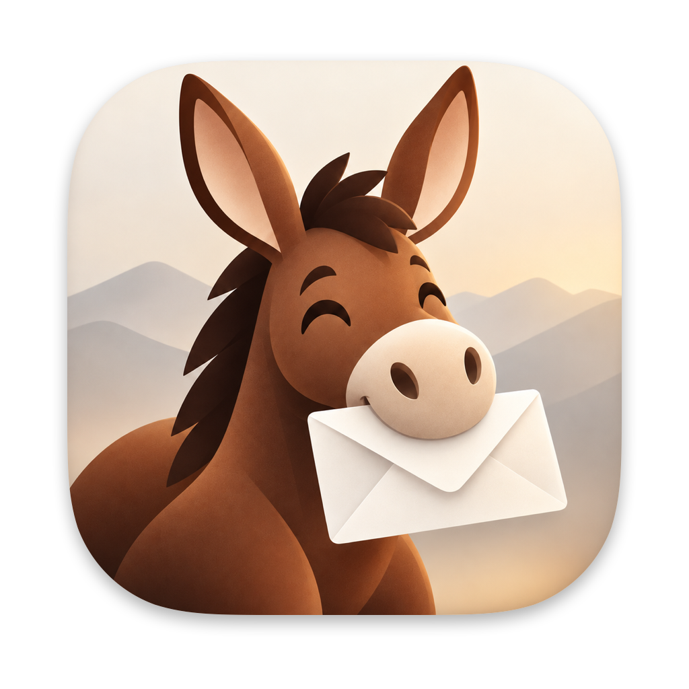
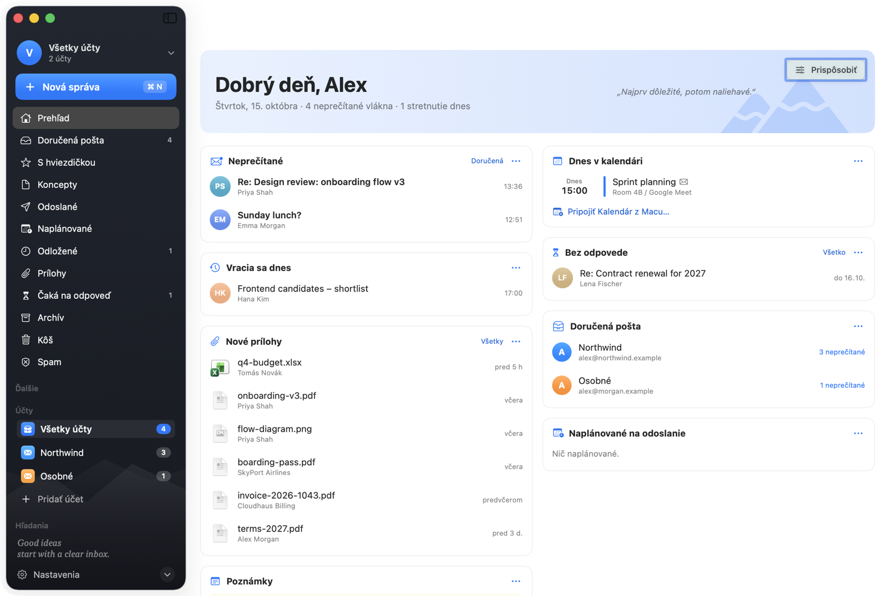
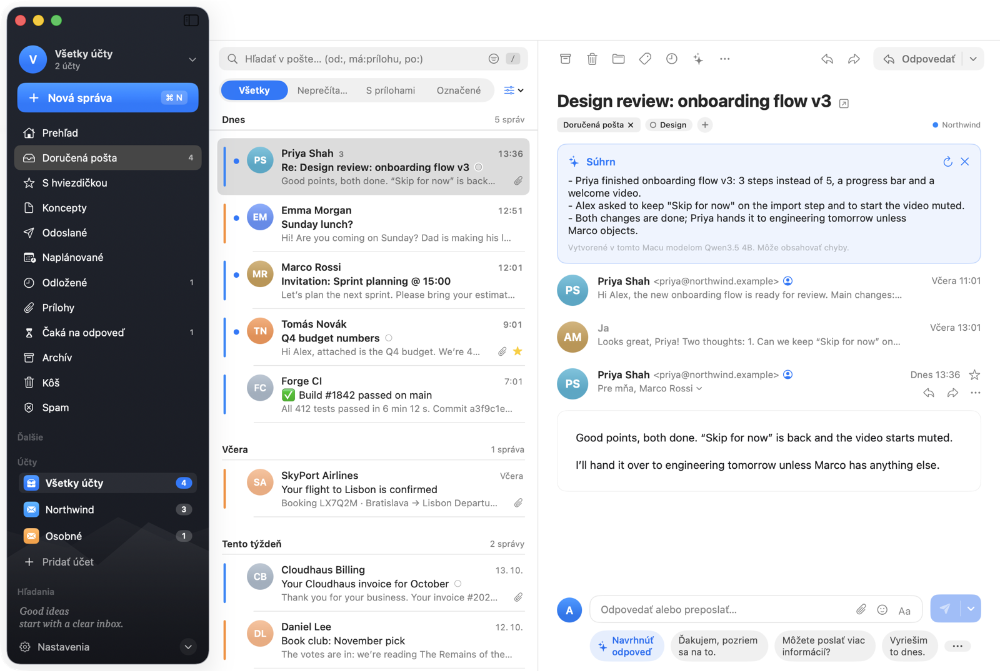
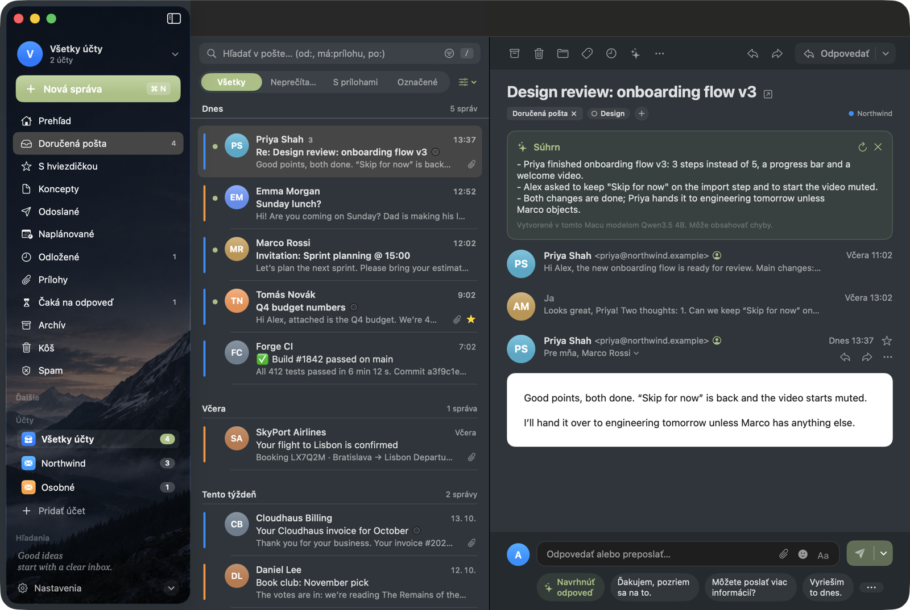
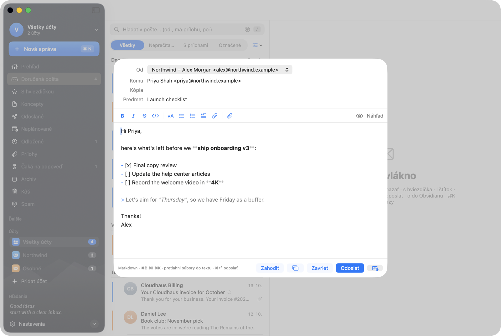
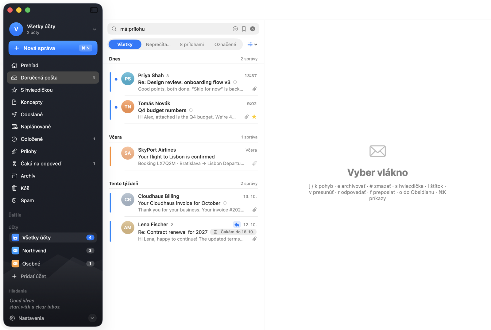
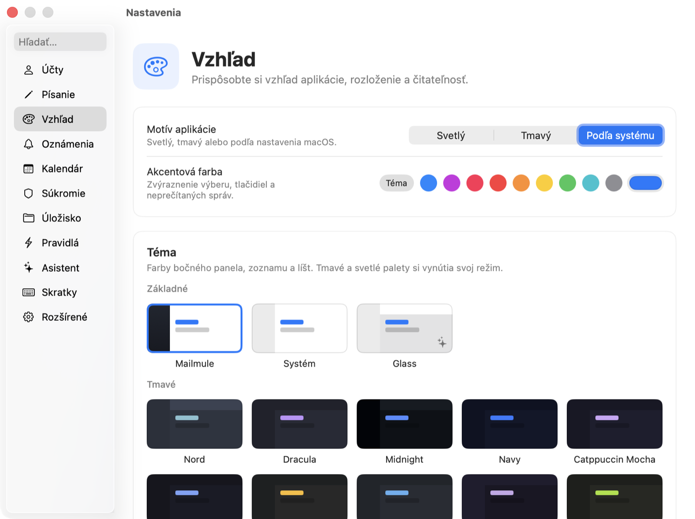

<p align="center"></p>

<h1 align="center">Mailmule</h1>

<p align="center">
A native macOS mail client in the spirit of Obsidian: your mail is plain files you own,<br>
you write in Markdown, drive everything from the keyboard, and send threads to your notes.
</p>

<p align="center">
<a href="LICENSE"></a>


</p>

<p align="center"></p>

---

## Why Mailmule

- **Your mail, your files.** Every message is kept as an `.eml` file and every thread as a Markdown note
  in a folder you choose (`~/Mail` by default). Spotlight, Obsidian, grep and backups just work.
  The SQLite database is only a cache.
- **Keyboard first.** Superhuman-style single-key shortcuts, a command palette, and shortcuts you can remap.
- **Private by design.** No servers of ours, no accounts, no telemetry. Mail goes straight between your Mac
  and your mail provider. The optional AI assistant runs a local model on your Mac, so your mail never leaves it.
  [Other network access](#network-access) is listed below, and each kind can be switched off.
- **Native.** SwiftUI and AppKit, with IMAP, SMTP and MIME written from scratch in Swift.

## Features

- **Accounts:** Gmail and any IMAP server, side by side. Unified inbox, account names and colours,
  SSL/TLS or STARTTLS, IMAP IDLE for instant new mail, CONDSTORE for fast syncing.
- **Home:** a dashboard with unread mail from VIPs, today's calendar (from the macOS Calendar and from
  invitations in your mail), threads waiting for a reply, snoozed mail coming back, scheduled messages
  and new attachments.
- **Triage:**
  - snooze, follow-up reminders ("remind me if they don't reply")
  - scheduled send, undo send, an outbox that retries when the network is back
  - labels, server folders, rules and automations, trackpad swipe actions
  - one-click newsletter unsubscribe, calendar invitations with RSVP
- **Search:** ignores accents, supports operators (`from:` `to:` `subject:` `with:` `has:attachment`
  `is:unread` `is:starred` `after:2026-09` `before:2026-10`), and searches can be saved in the sidebar.
- **Writing:** live Markdown editor, signatures, drag-and-drop attachments, drafts synced with the server,
  address completion from Contacts and your mail.
- **Assistant (optional):** thread summaries and reply suggestions from a local language model
  (Qwen via [MLX](https://github.com/ml-explore/mlx-swift)). It is downloaded once and runs on device.
- **More:**
  - attachment viewer with zoom, a person card with your history with someone
  - print and PDF export, multiple windows
  - tracking-pixel blocking, suspicious-sender warnings, 20+ themes
  - default mail app support (`mailto:`, Finder Services), Obsidian export with attachments

> **Language:** the user interface is currently in **Slovak** only. Localization is very welcome,
> see [Contributing](CONTRIBUTING.md).

## Screenshots

| | |
|---|---|
|  |  |
| A thread with its on-device summary and reply suggestions | One of 20+ themes, with a picture in the sidebar |
|  |  |
| Writing in live Markdown | Search with operators, saved to the sidebar in one click |

<p align="center"></p>

All screenshots show made-up demo data (`./scripts/demo.sh`, see [Contributing](CONTRIBUTING.md)).

## Install

There are no signed releases yet, so for now you build it yourself (below).

## Building

Requirements: macOS 15 or later, Xcode 26 or later, and [XcodeGen](https://github.com/yonaskolb/XcodeGen)
(`brew install xcodegen`).

One-time setup:

```sh
sudo xcode-select -s /Applications/Xcode.app
sudo xcodebuild -license accept
xcodebuild -downloadComponent MetalToolchain   # MLX compiles Metal shaders
```

Build and run:

```sh
echo <your Apple team ID> > scripts/team.local   # once; or set MAILMULE_TEAM
./scripts/build-app.sh && open build/Mailmule.app
```

- **Team ID.** Find it in Xcode → Settings → Accounts; a free Apple account is enough.
  `scripts/team.local` is not committed.
- **Signing.** A stable signature lets macOS remember Keychain access across builds.
- **First build.** It takes a while because of MLX.
- **Harmless error.** xcodebuild prints `error: … failed with exit code 0` at the end; you can ignore it.

To work in Xcode: `xcodegen generate && open Mailmule.xcodeproj`, then pick your team under Signing & Capabilities.
The Xcode project is generated and not committed; run `xcodegen generate` again after adding or removing files.

Core tests (no network, no UI):

```sh
cd Packages/MailmuleKit && swift test
# live STARTTLS handshakes, no login:
MM_NET_TESTS=1 MM_STARTTLS_IMAP=<imap host offering STARTTLS> swift test --filter StartTLS
```

### Releases

`./scripts/release.sh 0.2.0` builds a Developer ID signed, notarized DMG. It needs a paid Apple Developer
account; the steps are at the top of the script. `./scripts/release.sh --dev` makes an un-notarized DMG
for testing.

## Setting up an account

- **Gmail:** use an **app password** (https://myaccount.google.com/apppasswords; two-step verification
  must be on). OAuth is not supported yet.
- **IMAP:** server, port and security. SSL/TLS uses IMAP 993 and SMTP 465; STARTTLS uses IMAP 143 and
  SMTP 587. Mailmule never logs in over an unencrypted connection.

Passwords are stored in the macOS Keychain. Settings, without passwords, are backed up daily to
`~/Mail/.mailmule/settings-backup.json`.

## Network access

Besides your mail servers, Mailmule connects to the network only for the following:

- **Company logos for senders:** the sender domain's `apple-touch-icon.png`, falling back to DuckDuckGo's
  icon service. No cookies are sent. Switch it off in Settings → Privacy.
- **Remote images in messages:** only when you allow it, for each message or for trusted senders.
  Tracking pixels are blocked.
- **One-click unsubscribe:** only when you click it.
- **The language model:** downloaded from Hugging Face only when you turn on the assistant.

## Keyboard

| Key | Action |
|---|---|
| `j` / `k` | next / previous thread |
| `e` | archive |
| `#` / `⌫` | delete |
| `z` / `⌘Z` | undo |
| `r` / `a` / `f` | reply / reply all / forward |
| `c` | compose |
| `s` | star |
| `u` | read / unread |
| `l` / `v` | labels / move to folder |
| `h` | snooze |
| `o` | save thread to Obsidian |
| `/` | search |
| space | preview attachment |
| `⌘K` | command palette |
| `⌘R` | sync |
| `⌘P` | print / PDF |
| `⌘↩` | send (in the editor) |

All of them can be changed in Settings → Shortcuts.

## Links

- `mailmule://thread/<id>` opens a thread. Every thread note links back with one.
- `mailmule://compose?to=…&subject=…&body=…` starts a new message.
- `mailmule://home`, `mailmule://attachments`, `mailmule://settings/<page>`.

## The mail vault

```
~/Mail/
├── .mailmule/index.sqlite           cache (SQLite + FTS5), rebuilt if damaged
├── .mailmule/mailmule.log           app log
├── .mailmule/settings-backup.json   daily settings backup (no passwords)
├── accounts/<account>/raw/*.eml     original messages
├── drafts/*.md                      drafts (Markdown with front matter)
└── threads/*.md                     one Markdown note per thread
```

## Project layout

- `Packages/MailmuleKit`: the core, with no UI, tested with `swift test`
  - `Net/` connections (TLS via Network.framework, STARTTLS via a URLSession stream task)
  - `IMAP/` parser and client (Gmail extensions, CONDSTORE, IDLE)
  - `SMTP/` sending (TLS and STARTTLS)
  - `MIME/` parsing and building messages, iCalendar invitations, unsubscribe headers
  - `Store/` SQLite index and search
  - `Vault/` files, drafts, Markdown notes, Obsidian export
  - `Sync/` syncing and actions for one account
- `App/Sources`: the SwiftUI app
- `project.yml`: the Xcode project definition (XcodeGen)

## Contributing

Bug reports, ideas and pull requests are welcome. Please read [CONTRIBUTING.md](CONTRIBUTING.md) first.

## License

Mailmule is free software under the [GNU General Public License v3.0](LICENSE). You may use, study, share
and modify it. If you distribute modified versions, they must be released under the same license with
their source code.

Mailmule uses [MLX Swift](https://github.com/ml-explore/mlx-swift) and
[mlx-swift-lm](https://github.com/ml-explore/mlx-swift-lm) (MIT), and
[swift-transformers](https://github.com/huggingface/swift-transformers) and
[swift-huggingface](https://github.com/huggingface/swift-huggingface) (Apache-2.0).
Language models are downloaded from Hugging Face under their own licenses.
